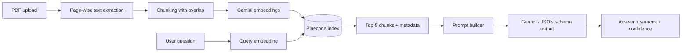

# 📄 PolicyGPT: PDF Q&A with RAG

A Retrieval-Augmented Generation (RAG) app that lets you upload a PDF and ask questions about it. Answers are grounded in the document, returned as validated structured output, and cite the **file and page** they came from.

**Stack:** Python · Google Gemini · Pinecone · Streamlit · Pydantic · pypdf

---

## ✨ Features

- **PDF upload and parsing**: page-wise text extraction with `pypdf`
- **Semantic search**: Gemini embeddings stored in a Pinecone serverless index
- **Grounded answers**: the model is instructed to answer only from retrieved context and to say so when the answer is not in the document
- **Structured output**: Gemini responses are constrained to a Pydantic JSON schema
- **Source citations**: every answer lists the `file - page N` it was built from
- **Confidence score**: based on retrieval similarity (cosine), not on the LLM's self-reported number
- **Idempotent ingestion**: documents are hashed, so uploading the same PDF twice does not duplicate vectors
- **Per-document search**: queries are filtered to the PDF currently loaded
- **Rate-limit handling**: automatic retry with backoff on Gemini free-tier `429` errors

---

## 🏗️ Architecture



---

## 📁 Project Structure

```
pdf-rag-assistant/
├── app.py                  # Streamlit UI
├── main.py                 # Query pipeline: retrieve → prompt → LLM → validate
├── config.py               # Environment variables and model settings
├── rag/
│   ├── pdf_loader.py       # PDF → [(page, text)]
│   ├── ingest.py           # Chunking, embedding, upsert to Pinecone
│   ├── retrieve.py         # Query embedding + Pinecone search
│   ├── prompt.py           # Grounded prompt template
│   └── store.py            # Pinecone client and index creation
├── models/
│   └── schema.py           # Pydantic schemas (LLM output + final answer)
├── utils/
│   └── gemini_client.py    # Embeddings + generation with retry logic
├── requirements.txt
├── .env.example
└── README.md
```

---

## 🚀 Getting Started

### Prerequisites

- Python 3.10 or newer
- A [Google AI Studio](https://aistudio.google.com) API key (free tier available)
- A [Pinecone](https://www.pinecone.io) API key (free Starter plan is enough)

### 1. Clone the repository

```bash
git clone https://github.com/mithxcode/pdf-rag-assistant.git
cd pdf-rag-assistant
```

### 2. Create a virtual environment and install dependencies

**Windows (PowerShell)**
```powershell
py -m venv venv
venv\Scripts\activate
python -m pip install -r requirements.txt
```

**macOS / Linux**
```bash
python3 -m venv venv
source venv/bin/activate
pip install -r requirements.txt
```

### 3. Configure environment variables

Copy the template and add your keys:

```bash
cp .env.example .env        # Windows: copy .env.example .env
```

```env
GEMINI_API_KEY=your_gemini_key
PINECONE_API_KEY=your_pinecone_key
```

> ⚠️ `.env` is listed in `.gitignore`. Never commit your API keys.

### 4. Run the app

```bash
python -m streamlit run app.py
```

Open `http://localhost:8501`, upload a PDF, wait for the "PDF processed" message, then ask a question.

The Pinecone index is created automatically on first run.

---

## ⚙️ Configuration

| Variable | Required | Default | Description |
|---|---|---|---|
| `GEMINI_API_KEY` | Yes | n/a | Google Gemini API key |
| `PINECONE_API_KEY` | Yes | n/a | Pinecone API key |
| `PINECONE_INDEX` | No | `policygpt-gemini` | Index name |
| `PINECONE_CLOUD` | No | `aws` | Pinecone serverless cloud |
| `PINECONE_REGION` | No | `us-east-1` | Pinecone serverless region |

Model settings live in `config.py`:

| Setting | Value |
|---|---|
| Embedding model | `gemini-embedding-001` (768 dimensions) |
| LLM | `gemini-2.5-flash` |
| Top-K retrieval | 5 |
| Similarity metric | Cosine |

> If you change `EMBED_DIM`, use a new index name. A Pinecone index cannot change dimension after creation.

---

## 🔍 How It Works

1. **Ingest**: the PDF is split page by page, then into ~800-character chunks with 150 characters of overlap, cut at sentence or word boundaries. Each chunk is embedded and upserted with metadata (`text`, `source`, `page`, `doc_id`).
2. **Retrieve**: the question is embedded as a retrieval query and the top-5 most similar chunks are fetched, filtered to the current document.
3. **Generate**: the chunks are passed to Gemini with strict instructions to answer only from context. The response is forced into a JSON schema (`answer`, `used_chunks`, `found_in_context`).
4. **Validate and cite**: the app maps `used_chunks` back to file and page, and computes confidence from the similarity score of the chunks actually used.

**Example response**
```json
{
  "answer": "Employees are entitled to 24 days of paid leave per year.",
  "sources": ["hr_policy.pdf - page 7"],
  "confidence": 0.812
}
```

---

## ⚠️ Known Limitations

- **Scanned PDFs** are not supported. Text extraction returns nothing without OCR.
- **Tables and complex layouts** may be extracted in a flattened or jumbled order.
- **Gemini free tier** has rate limits. Large PDFs can take longer because of automatic retries.
- Retrieval is a single dense-vector search. There is no hybrid (keyword) search or re-ranking yet.

---

## 🛣️ Roadmap

- [ ] OCR support for scanned documents
- [ ] Multi-PDF chat with a document selector
- [ ] Conversation history and follow-up questions
- [ ] Hybrid search and re-ranking
- [ ] Retrieval evaluation (hit rate / MRR) on a small test set
- [ ] Docker setup and Streamlit Cloud deployment

---

## 🧰 Tech Stack

| Layer | Technology |
|---|---|
| UI | Streamlit |
| LLM and embeddings | Google Gemini (`google-genai`) |
| Vector database | Pinecone (serverless) |
| Validation | Pydantic v2 |
| PDF parsing | pypdf |
| Config | python-dotenv |

---

## 👤 About the Author

### Mithilesh Kumar | AI Engineer & Backend Systems Develope

I build autonomous AI applications, agentic workflows, scalable backend systems and high-performance RAG pipelines. PolicyGPT is one of my projects in this space. It shows how I approach retrieval quality, grounded answers, structured outputs and source citations, not just a chat demo.

I am a Computer Science & Engineering student at **Chandigarh Engineering College (CEC), CGC Landran, Mohali** (B.Tech, 2023 to 2027), originally from Banka, Bihar, India.

**What I work on**
- Multi-agent systems and agentic workflows
- Retrieval-Augmented Generation (RAG) pipelines
- Backend APIs and scalable AI services

**Tech I use:** Python · FastAPI · LangGraph · LangChain · OpenAI · Google Gemini · Pinecone · Streamlit

**Find me online**

| Platform | Link |
|---|---|
| 🌐 Portfolio | [mithilesh-kumar-ai-engineer.netlify.app](https://mithilesh-kumar-ai-engineer.netlify.app/) |
| 💼 LinkedIn | [linkedin.com/in/mithileshkumar001](https://www.linkedin.com/in/mithileshkumar001) |
| 💻 GitHub | [github.com/mithxcode](https://github.com/mithxcode) |
| ✍️ DEV Community | [dev.to/mithxcode](https://dev.to/mithxcode) |
| 🐦 X (Twitter) | [x.com/MITHILESH_7781](https://x.com/MITHILESH_7781) |

> Looking for AI Engineer or Backend Developer opportunities and open-source collaborations. Feel free to connect.

<sub>Keywords: Mithilesh Kumar, AI Engineer, Backend Developer, RAG, Multi-Agent Systems, LangGraph, FastAPI, Python</sub>

---

## 📜 License

This project is for learning and portfolio purposes. Add a license of your choice (for example MIT) before reusing it commercially.
